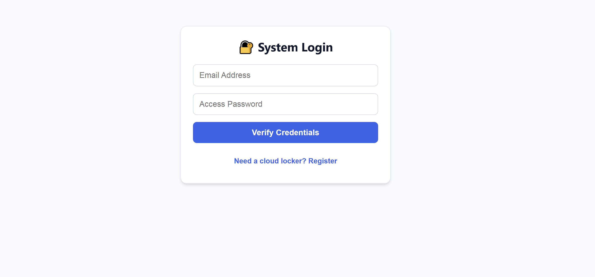
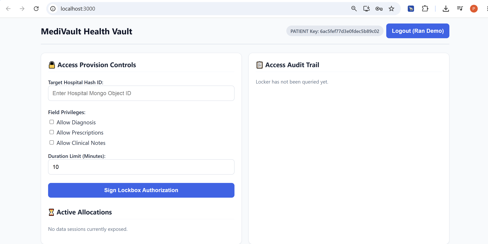
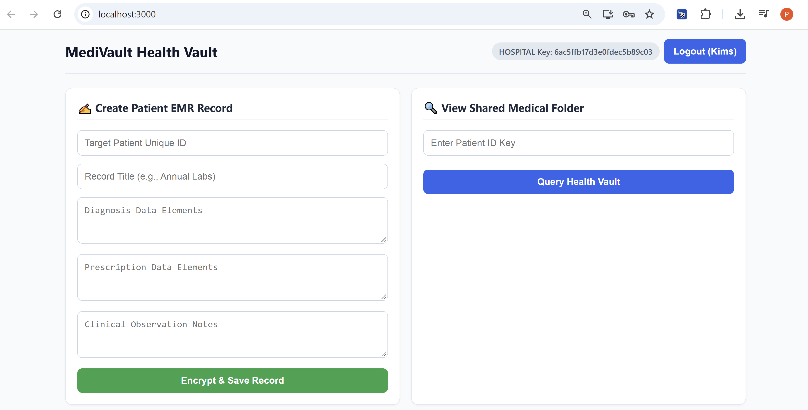
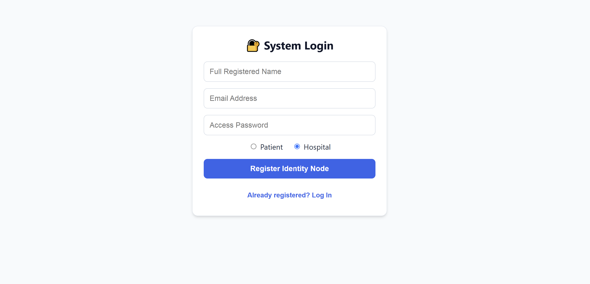

🌐 Project Overview

MediVault is a digital health locker system that gives patients absolute control over who views their medical files. In standard hospital systems, once your data is uploaded, any department or affiliated doctor can often view your entire medical file.
MediVault fixes this by acting as a secure intermediary locker:
1. Military-Grade Storage: When a hospital creates a medical record, the sensitive details (Diagnosis, Prescriptions, Notes) are encrypted using AES-256-CBC algorithms before ever touching the database. Even if hackers leak the database, the data looks like random junk text.
2. Granular Access Control: If an external doctor needs to look at a patient's history, the patient logs into their dashboard and provisions a temporary token. The patient can choose to share only the Diagnosis while locking away private clinical notes.
3. Temporal Self-Destruction: Every permission slip has a hard countdown timer (e.g., 5 minutes). Once it ticks down to zero, the access key dissolves automatically. The patient can also hit "Revoke Early" to cut off access instantly mid-session.
4. Absolute Transparency: Every query a hospital performs is recorded in an unalterable Audit Trail, which the patient can export to a CSV spreadsheet to inspect for compliance.

📸 Updated README.md Block (With Screenshot Dynamic Embeds)

To display your 4 screenshots beautifully on GitHub or any markdown viewer, add this visual display section right after the "Key Features" section in your README.md file:
markdown
## 🖼️ Application Interface & System Walkthrough

Here is a visual step-by-step breakdown of the MediVault system in action, captured directly from the responsive mobile-friendly terminal dashboards.

### 1. Unified Security Portal (Authentication & Registration)
The system gateway features an intuitive toggle to separate incoming patient workflows from clinical hospital administrative operations.

### 2. Granular Consent Configuration Terminal (Patient View)
Patients can copy their unique cryptographic identifier keys, selectively toggle field-level access parameters, and manage active allocations with live countdown timers.

### 3. Clinical Data Ingestion & Encrypted Storage Form (Hospital View)
Hospitals use this dashboard grid to input EMR parameters, which are instantly encrypted via AES-256 before being committed to the MongoDB cluster tier.

### 4. Shared Medical Folder & Compliance Audit Trail
External facilities view shared folders with masked fields (`🚫 Restricted`) for non-authorized items, while patients monitor activities through a download-ready access trail.
